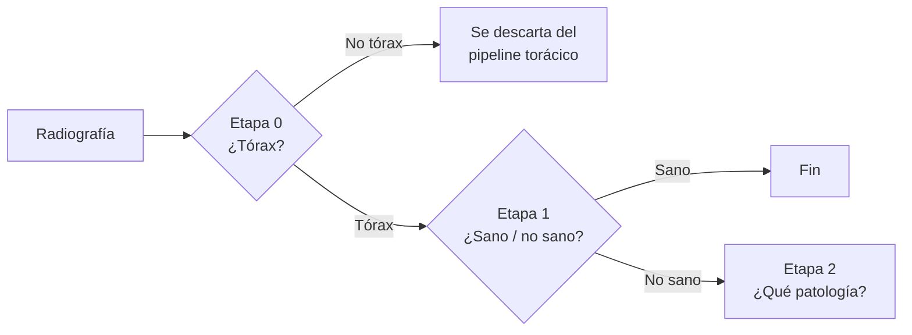

# VetVision AI

Sistema de diagnóstico radiológico veterinario asistido por IA para radiografías de **perros y gatos**,
pensado como una alternativa en español para Latinoamérica a soluciones como SignalPET (EE.UU.).

Es el Proyecto Final de Grado (PFG) de Ingeniería en Sistemas de Información de la Universidad de la
Cuenca del Plata (Corrientes, Argentina), con intención real de viabilidad comercial. Autores: Stiven y
Lucas. **Prototipo académico: no es un dispositivo médico certificado.**

> Este README es la referencia general del proyecto. El detalle de cada entrenamiento (configuración,
> resultados por época, duración, decisiones) está en [ENTRENAMIENTOS.md](ENTRENAMIENTOS.md).

## Resultado en una mirada

El primer filtro del sistema (**Etapa 0: ¿la radiografía es de tórax o no?**) ya está entrenado y supera
el umbral de promoción que nos pusimos:

| Métrica (sobre 1603 imágenes que el modelo nunca vio) | Valor |
|---|---|
| Exactitud balanceada | **92,45 %** (umbral: 90 %) |
| Exactitud (accuracy) | 92,70 % |
| F1 (macro) | 92,63 % |

Cómo llegamos ahí (las tres corridas reales; detalle en [ENTRENAMIENTOS.md](ENTRENAMIENTOS.md)):

| # | Configuración | Épocas | Resultado | Lectura |
|---|---|---|---|---|
| 1 | Backbone congelado (validación rápida) | 3 | 81,22 % accuracy | Validó el pipeline completo por primera vez; destapó 3 bugs reales |
| 2 | Backbone congelado | 15 | 85,17 % exactitud balanceada | Se **estancó** desde la época ~4: el límite era la capacidad del modelo, no las épocas |
| 3 | **Fine-tuning parcial** (`denseblock4` + `norm5`) | 15 | **92,45 %** exactitud balanceada | Siguió mejorando hasta la última época, sin sobreajuste |

## Cómo está pensado el sistema

Es una **cascada**: cada etapa filtra lo que llega a la siguiente.



| Etapa | Qué hace | Estado |
|---|---|---|
| **0** | Clasificador binario TÓRAX / NO TÓRAX | **Implementada y entrenada** |
| 1 | Triaje sano / no sano | Pendiente: necesita anotación clínica |
| 2 | Patología torácica (alveolar, efusión pleural, intersticial, otro) | Pendiente: necesita anotación clínica; se inicializa desde los pesos de la Etapa 1 |

**Por qué la Etapa 0 es binaria:** todas las patologías de la Etapa 2 son torácicas, así que las demás
regiones (cuello, abdomen, pelvis, extremidades, cráneo) no necesitan clasificarse entre sí: alcanza con
descartarlas. Además es la **única etapa que no depende de anotación clínica**, porque su etiqueta sale
automáticamente de la metadata de cada estudio.

## Datos

- **Origen:** radiografías reales del Hospital de Clínicas de la Facultad de Ciencias Veterinarias
  (F.C.V., UNNE), capturadas con un equipo Fujifilm FCR PRIMA (radiografía computarizada).
- **Volumen usado:** 8.015 imágenes (de 8.158 estudios extraídos; los ~143 restantes no tienen imagen
  decodificada). Reparto de clases: 4.219 NO TÓRAX y 3.796 TÓRAX (52,6 % / 47,4 %, sin desbalance fuerte).
- **Validación:** 80/20 con semilla fija (42): 6.412 imágenes de entrenamiento y 1.603 de validación.
  Los índices de validación se guardan junto al modelo para poder reevaluar siempre sobre el mismo conjunto.
- **Etiquetas de la Etapa 0:** salen del campo "región anatómica" del `.txt` de cada estudio. Un estudio
  con región desconocida se **excluye**, nunca se fuerza a una clase (en el dataset actual: 0 excluidos).

### El problema de extraer los datos (y cómo se resolvió)

El equipo guarda cada radiografía en 8 archivos internos y su visor oficial depende de un componente
obsoleto de Windows. Se hizo **ingeniería inversa** del formato:

- El `.ddo` (metadata) tiene una estructura parecida a DICOM pero **no es DICOM válido**: la longitud de
  cada campo ocupa siempre 4 bytes. Se escribió un parser propio en Python ([src/ddo_parser.py](src/ddo_parser.py)).
- El `.hq` resultó ser **JPEG-Lossless de 16 bits**, de mayor calidad que el jpg que exporta el sistema;
  se decodifica a PNG sin pérdida.
- Por estudio se conserva: `.ddo` original + `.txt` de metadata legible + `.png` de 16 bits + `.jpg`
  procesado. El resto (`.dsp`, `.std`, `.edk`, `.edr`, miniatura) se aparta sin borrarse.

Detalle técnico completo: [formato_ddo_hq_FCR_PRIMA.md](formato_ddo_hq_FCR_PRIMA.md). Script de
extracción: [limpiar_datos_fcr.py](limpiar_datos_fcr.py) (corre primero en modo simulación).

> **El dataset no está en el repositorio** (contiene datos de pacientes). Las imágenes y archivos
> del equipo están en `.gitignore`. La anonimización de los datos antes de cualquier subida a la nube está
> especificada pero **todavía no implementada**.

## Modelo y entrenamiento

- **Backbone:** DenseNet-121 preentrenado en radiografías de **tórax humano** (TorchXRayVision). No existe
  un modelo fundacional veterinario: toda la literatura parte de un backbone humano y lo ajusta.
- **Técnica:** *transfer learning* con **fine-tuning parcial**. Se entrena la capa de salida nueva y solo
  el último bloque denso (`denseblock4`) más `norm5`: **2,16 M de los 6,95 M de parámetros**. Las capas
  tempranas (bordes, texturas) quedan congeladas porque son genéricas y con ~6.400 imágenes de
  entrenamiento sería fácil sobreajustar.
- **Learning rate diferenciado:** `1e-4` para la capa nueva y `1e-5` (10 veces menos) para el backbone, para
  no destruir lo que ya sabe.
- **Preprocesamiento:** jpg en escala de grises → **CLAHE** (contraste local) → 512 × 512 → normalización al
  rango ~[-1024, 1024] que espera TorchXRayVision. **1 solo canal**, no RGB.
- **Entrenamiento:** Adam, pérdida CrossEntropy, batch 8, 15 épocas, en **CPU** (~8 h por corrida de 15
  épocas; la GPU de la máquina es AMD y PyTorch solo acelera con CUDA de forma directa).
- **Criterio de promoción:** exactitud **balanceada** ≥ 90 % (no accuracy simple, que puede esconder un mal
  desempeño en la clase minoritaria). Se guarda el checkpoint de la **mejor época**, no el de la última.

### Lecciones aprendidas (bugs reales encontrados al correr todo por primera vez)

1. **Emparejamiento por prefijo:** la búsqueda de imágenes por `glob("FCR1*")` podía asociar la metadata de un
   paciente con la imagen de otro (`FCR1` con `FCR10.jpg`). Corregido con búsqueda por nombre exacto.
2. **Canales:** el backbone espera 1 canal y el código convertía a RGB (3 canales).
3. **Escala de píxeles:** se usaba `[0, 1]` pero TorchXRayVision espera ~`[-1024, 1024]`.

Los tres tienen test de regresión. Más contexto en [ENTRENAMIENTOS.md](ENTRENAMIENTOS.md), Corrida 1.

## Tecnologías

**Usadas en el entrenamiento y la demo:**

| Tecnología | Versión | Para qué |
|---|---|---|
| Python | 3.13 | Lenguaje de todo el proyecto |
| PyTorch | 2.14 | Deep learning: modelo, entrenamiento, optimizador |
| TorchXRayVision | 1.5.4 | DenseNet-121 preentrenado en tórax y su normalización de entrada |
| OpenCV | 5.0 | Lectura de imágenes, CLAHE, redimensionado |
| NumPy | 2.5 | Arrays de imagen |
| scikit-learn | 1.9 | Métricas: exactitud balanceada, accuracy, F1 |
| MLflow | 3.16 | Seguimiento de hiperparámetros y métricas por época |
| Pillow + pylibjpeg | 12.3 / 2.1 | Solo en la extracción: decodificar `.hq` (JPEG-Lossless) y guardar PNG de 16 bits |
| ONNX | 1.22 | Exportación del modelo a formato portable |
| pytest | | 61 tests automáticos |
| spec-kit | | Flujo de desarrollo guiado por especificaciones (ver más abajo) |

**Declaradas en `requirements.txt` pero sin uso todavía** (no atribuirlas en la presentación):
`albumentations` (no hay aumentación de datos), `pandas`, `dvc` (está inicializado pero sin remoto
configurado, no versiona nada) y `onnxruntime` (el código no lo importa).

## Cómo correrlo

### Instalación

```bash
python -m venv venv
venv\Scripts\activate          # Windows; en Linux/Mac: source venv/bin/activate
pip install -r requirements.txt
```

En **Windows**, la primera vez que se descarga el modelo base de TorchXRayVision hay que definir
`PYTHONIOENCODING=utf-8` (PowerShell: `$env:PYTHONIOENCODING = "utf-8"`); si no, la descarga se corta por un
carácter de su barra de progreso.

### Tests, entrenamiento y evaluación

```bash
pytest                                           # 61 tests
python -m harness                                # contratos + guardia de datos personales + tests

python -m src.train --data-dir <ruta_al_dataset_limpio> --epochs 15 --batch-size 8 --lr 1e-4 \
    --unfreeze-layers denseblock4,norm5          # la configuración de la Corrida 3
python -m src.evaluate --data-dir <ruta_al_dataset_limpio> --model-path models/etapa0_region.pt
python -m src.export_onnx --model-path models/etapa0_region.pt
mlflow ui                                        # gráficos por época en localhost:5000
```

El entrenamiento deja `models/etapa0_region.pt` (mejor época) y `models/etapa0_region_val_indices.json`
(qué imágenes quedaron fuera del entrenamiento). Sin `--unfreeze-layers` el backbone queda 100 % congelado.

### MVP web

Carga una radiografía, corre la puerta de región y el modelo de hallazgos (si existe), y deja
validar, corregir o descartar cada hallazgo hasta cerrar el informe. Un solo comando (con el
entorno activado):

```bash
python -m app
```

Abre `http://127.0.0.1:8000/`. Pasos de uso y detalle en [specs/004-mvp-web/quickstart.md](specs/004-mvp-web/quickstart.md).

> El checkpoint `models/etapa0_region.onnx` **no se versiona** (`models/` está en `.gitignore`): se
> comparte por fuera del repositorio y debe colocarse en esa ruta. Si no está, la aplicación arranca
> igual y lo avisa; la carga de estudios responde con un error claro hasta que el archivo esté
> presente. El MVP no necesita el dataset: la base y las imágenes cargadas se guardan en `data/app/`
> (también gitignorado).
>
> La demo anterior de una sola pantalla (`server.py`, `VetVision Demo.dc.html`) quedó reemplazada por
> este MVP y se retiró del repositorio (2026-11-17).

## Estructura del repositorio

```
├── src/                    # código del modelo
│   ├── ddo_parser.py       #   parser del .ddo binario (formato tipo DICOM, reverse-engineered)
│   ├── parser_fcr.py       #   lee el .txt de metadata y normaliza región/vista/especie
│   ├── preprocessing.py    #   CLAHE + redimensionado a 512x512, 1 canal
│   ├── dataset.py          #   Dataset de PyTorch y etiquetado TORAX / NO_TORAX
│   ├── model.py            #   DenseNet-121 + cabeza nueva, con fine-tuning parcial
│   ├── train.py            #   entrenamiento (MLflow, mejor checkpoint, semilla fija)
│   ├── evaluate.py         #   exactitud balanceada sobre el conjunto de validación fijo
│   └── export_onnx.py      #   exportación a ONNX
├── limpiar_datos_fcr.py    # extracción y clasificación de los archivos del equipo de rayos X
├── harness/                # verificación automática: contratos, guardia de datos, tests
├── tests/                  # 61 tests automáticos
├── specs/                  # especificaciones (ver más abajo)
├── notebooks/              # exploración del dataset
├── ENTRENAMIENTOS.md       # bitácora de cada corrida de entrenamiento
├── formato_ddo_hq_FCR_PRIMA.md   # ingeniería inversa del formato del equipo
└── CLAUDE.md               # guía de trabajo del repositorio para el asistente de código
```

`models/` y `data/` existen solo localmente (ignorados por git).

## Metodología: desarrollo guiado por especificaciones (SDD)

Se usa [spec-kit](https://github.com/github/spec-kit): cada feature pasa por
**constitution → specify → plan → tasks → implement**, y los documentos quedan en `specs/NNN-nombre/`.
Las reglas del proyecto están en `.specify/memory/constitution.md` (cinco principios: spec primero, specs
basados en datos reales, test-first para parsers, protección de datos de pacientes y simplicidad).

| Feature | Qué cubre | Estado |
|---|---|---|
| `001-fcr-metadata-extraction` | Parser del `.ddo` y del `.txt`, decodificación del `.hq` | Implementada |
| `002-etapa0-torax-clasificador` | Clasificador binario de Etapa 0 | Implementada y entrenada |
| `003-harness-verificacion-automatica` | CI, validación automática de specs contra el código, guardia de datos personales | Implementada (`python -m harness`, CI `verificar`) |

Además hay tres contratos en `specs/*.spec.yaml` (tensores del modelo, etiquetas, datos). El harness
(`python -m harness contratos`) compara parte de sus campos contra el código en cada cambio y en CI; los
campos que todavía no tienen verificador se informan como `sin_verificacion`. Ya hubo desvíos reales
entre contrato y código, y por eso existe ese control.

## Limitaciones conocidas

- **Errores en imágenes con más de tórax:** el modelo falla más cuando, además del tórax, se ven las patas
  u otras zonas, porque cada estudio tiene una sola etiqueta de región. En una muestra de 120 imágenes de
  validación acertó 112 (93 %).
- **Solo la Etapa 0 está implementada.** La cascada completa depende de la anotación clínica por parte de un
  profesional veterinario.
- Entrenamiento en CPU (~8 h por corrida); sin aumentación de datos.
- La anonimización de datos de pacientes no está implementada.
- La demo web se construyó fuera del flujo SDD por el plazo de la presentación; falta retro-especificarla.

## Próximos pasos

1. Conseguir y procesar la anotación clínica (sano / no sano y patología) para las Etapas 1 y 2.
2. Mejorar la Etapa 0: análisis de los errores concretos, aumentación de datos, descongelar un bloque más.
3. Ampliar el harness: verificadores para los campos de contrato que hoy quedan `sin_verificacion`.
4. Implementar la anonimización y configurar el versionado del dataset (DVC) antes de subir datos a la nube.
5. Retro-especificar la demo web como feature aparte.

## Guía para armar la presentación

**Mensajes que el proyecto sostiene con evidencia:**

- Se resolvió un problema real de acceso a datos (formato propietario sin software disponible) por
  ingeniería inversa.
- Una cascada de etapas, donde la primera no necesita anotación clínica y ya funciona con 92,45 % de
  exactitud balanceada sobre datos que el modelo no vio.
- La mejora de 85 % a 92 % vino de una decisión de ingeniería medida (fine-tuning parcial), no de "entrenar
  más": la Corrida 2 demostró que más épocas no ayudaban.
- Rigor: semilla fija, conjunto de validación reproducible, métrica que no se infla con el desbalance,
  tests de regresión de cada bug encontrado.

**Qué decir con honestidad:** el modelo falla en imágenes con anatomía mezclada; solo la primera etapa
está hecha; la anotación clínica es el cuello de botella hacia el diagnóstico real; es un prototipo
académico, no un producto médico.

**Material de apoyo:** gráficos por época con `mlflow ui`; tablas de las tres corridas en
[ENTRENAMIENTOS.md](ENTRENAMIENTOS.md); la demo funcionando con imágenes del conjunto de validación.
