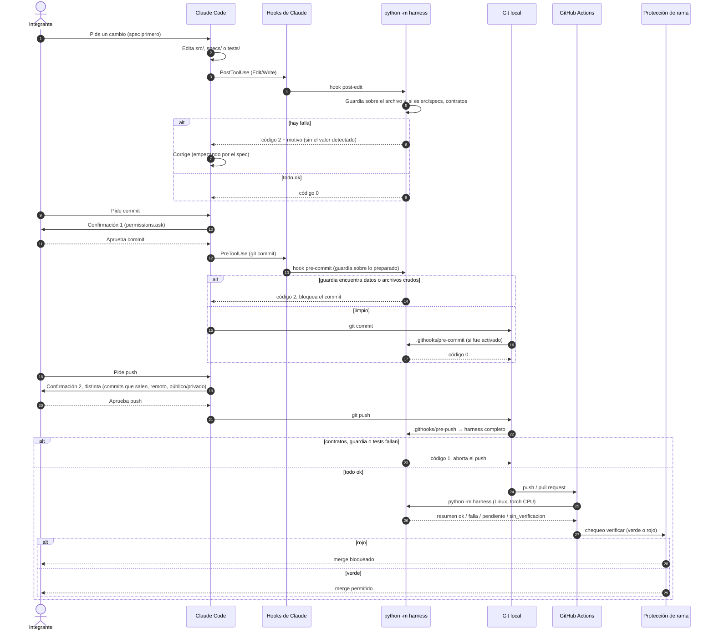

# Harness: flujo completo, de la edición al merge

Contexto: `specs/003-harness-verificacion-automatica/`. Tres capas con la misma verificación.

| Capa | Cuándo corre | Qué corre | Si falla |
|---|---|---|---|
| Hooks de Claude (`.claude/settings.json`) | Al editar `src/`, `specs/`, `tests/` y antes de un `git commit` hecho por Claude | Guardia (y contratos si es `src/` o `specs/`) | Código 2: bloquea o avisa con el motivo |
| Hooks de git (`.githooks/`, requieren `python scripts/instalar_hooks.py`) | `git commit` / `git push` desde cualquier lado | `pre-commit`: guardia sobre lo preparado. `pre-push`: harness completo | Aborta el commit o el push |
| CI (`.github/workflows/verificar.yml`) | Cada push y pull request | `python -m harness` | Chequeo `verificar` en rojo |

> La protección de rama es una configuración de GitHub del dueño del repo; sin ella el CI avisa pero no bloquea el merge.
