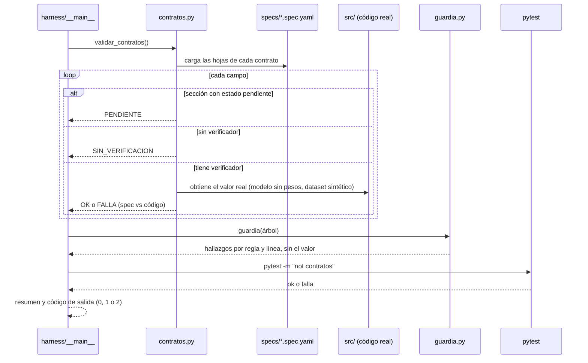

# Harness: qué hace `python -m harness` por dentro

Códigos de salida: `0` sin fallas, `1` al menos una falla, `2` error interno del harness
(nunca se interpreta como "pasó"). Contexto: `specs/003-harness-verificacion-automatica/`.

